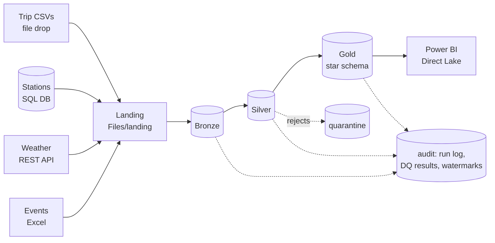

# YarraRide: an end-to-end Microsoft Fabric lakehouse

A bike-share analytics platform built the way a production data team would build it: **four heterogeneous sources → Landing → Bronze → Silver → Gold → Power BI**, with audit columns on every layer, incremental loads, SCD Type 2, a data-quality framework that quarantines bad rows, and automated tests that prove it works.

> The scheme ("YarraRide"), its trips, stations and events are **synthetic**. Weather arrives through a mock of the Open-Meteo API response (a live mode is included). The point of the project is the engineering.




## Skills demonstrated

| Skill | Where to look |
|---|---|
| Lakehouse + Medallion design | `src/bikeshare/{landing,bronze,silver,gold}.py`, [docs/architecture.md](docs/architecture.md) |
| PySpark | everything under `src/bikeshare/` |
| Data Factory orchestration | [pipelines/pl_bikeshare_master.json](pipelines/pl_bikeshare_master.json) (notebook activities, retry, failure branch, semantic-model refresh) |
| Delta tables | `lakehouse.py` (`MERGE`, `replaceWhere`, `mergeSchema`), notebook 05 (history, time travel, OPTIMIZE/VACUUM) |
| API integration | `sources/weather_client.py` (back-off retries), `landing.land_weather` (date window + look-back) |
| Incremental loads | watermarks + file ledger in `control.py`; per-layer watermarks; marts rebuilt only for affected dates |
| SCD Type 2 | `scd2.py` (staged `MERGE`, multi-version chaining, late-arrival handling), point-in-time join in `gold.build_fact_trip` |
| Data modelling | star schema, role-playing station dimension, Unknown members, junk-free small dims ([docs/architecture.md](docs/architecture.md)) |
| Data quality | `dq.py`, quarantine tables, circuit breaker, reconciliation checks, **ground-truth test** ([docs/data_quality.md](docs/data_quality.md)) |
| Analytics engineering | marts, DAX measures ([powerbi/measures.dax](powerbi/measures.dax)), semantic model spec, tests as documentation |
| Power BI | [powerbi/semantic_model.md](powerbi/semantic_model.md), [powerbi/report_guide.md](powerbi/report_guide.md), HTML preview in [dashboard/](dashboard/index.html) |

## Sources (all deliberately messy)

| Source | Type | Landing pattern |
|---|---|---|
| Daily trip files | CSV drop | copy files not yet landed; file ledger makes ingestion idempotent; a column appears mid-stream (schema drift) |
| Stations | SQL database (SQLite here, Azure SQL in production) | `WHERE modified_at > watermark` → Parquet; in-place `UPDATE`s become SCD2 history |
| Weather | REST API (Open-Meteo shape) | date window with 1-day look-back → raw JSON |
| City events | Excel workbook | banner rows, text numbers and dates; copied when its content hash is new |

## Data quality, the interview highlight

The simulator injects **14 kinds of production defects** and writes a ground-truth ledger the pipeline never sees. A test reconciles the ledger with what Silver quarantined or flagged:

| Injected defect | Injected | Caught | Where |
|---|---:|---:|---|
| end before start | 165 | 165 | quarantine `end_not_before_start` |
| trip over 24h | 55 | 55 | quarantine `duration_le_24h` |
| negative fare | 49 | 49 | quarantine `fare_non_negative` |
| missing trip id | 112 | 112 | quarantine `trip_id_not_null` |
| invalid rider type | 95 | 95 | quarantine `rider_type_valid` |
| future-dated | 35 | 35 | quarantine `not_future_dated` |
| missing end station | 476 | 476 | kept + flagged (`warn`) |
| orphan start station | 102 | 102 | kept + flagged, mapped to Unknown member |
| false start under 60s | 840 | 839 | kept + flagged |

Cosmetic problems (casing, whitespace, alternate date format, label variants), exact duplicates and next-day replays are repaired or collapsed instead of rejected. Three-tier policy (reject / keep-and-flag / repair), a 5% circuit breaker, and every rule result in `audit.dq_results`. Details: [docs/data_quality.md](docs/data_quality.md).

## Results from the local run (4 incremental batches, then a re-run)

* 104,015 Bronze trip rows → **103,025** Silver/Gold trips, **511** quarantined, 479 duplicates collapsed (all accounted for)
* Re-running a batch changes **nothing** (row counts identical in all layers)
* `dim_station`: S001 has 3 versions (capacity 30 → 40 → 44); trips are attributed to the version valid at trip time
* 118 pipeline steps, all succeeded; critical reconciliation checks passed on every batch
* 18 automated tests pass (6 unit, 12 end-to-end)

## Run it locally

```bash
pip install -r requirements.txt            # Java 11/17 required
make run                                   # Delta Lake, 4 incremental batches -> ./lakehouse_local
make test                                  # full suite on Delta Lake
BIKESHARE_FORMAT=parquet make test-offline # same logic on a Parquet stand-in (no Delta jar download)
```

## Run it in Microsoft Fabric

1. Create a workspace and a **schema-enabled lakehouse** named `lh_yarraride`.
2. Upload the repo's `src/` folder to the lakehouse at `Files/code/src/`.
3. then create `notebooks/*.ipynb` into the workspace and attach the lakehouse as default.
4. Run notebook `00` once to create the simulated sources, then `01` → `04` in order (or import the pipeline JSON and replace the `<PLACEHOLDER>` ids with your notebook / workspace ids).
5. Create a Direct Lake semantic model on the `gold` and `audit` schemas, add the relationships and measures from `powerbi/`, then build the four report pages from the guide.
6. Schedule the pipeline daily. Set `weather_live = True` to call the real Open-Meteo API.

## Honest status (what was and was not verified)

Verified by running it: the simulator, all PySpark logic, SCD2, incremental/idempotent behaviour, DQ and quarantine, marts, the dashboard preview (rendered and inspected), and the test suite, using PySpark 4.2.

**Not executed yet**, because they need things my build environment did not have:

* **Delta Lake itself.** The sandbox could not download the Delta jars, so the suite was run in `BIKESHARE_FORMAT=parquet`, a stand-in with the same semantics. The Delta calls (`MERGE`, `replaceWhere`, `mergeSchema`, `OPTIMIZE`/`VACUUM`) are isolated in `lakehouse.py` and follow the documented API, but run `make test` once on your machine or in CI (the included GitHub Action runs both formats).
* **Fabric Runtime 1.3 (Spark 3.5)**: local runs used PySpark 4.2. The code avoids Spark 4-only APIs by intent but this is unconfirmed.
* **Fabric artifacts**: notebooks import and pipeline JSON are templates that have not been imported into a workspace, and the Power BI model and DAX were not validated in Power BI Desktop. `dashboard/index.html` is an HTML preview of the report design, not a `.pbix`.
* The live Open-Meteo call (mock is the default).

## Layout

```
src/bikeshare/   library: config, lakehouse (storage layer), audit, control, dq, scd2, landing, bronze, silver, gold, pipeline
src/bikeshare/sources/   source-system simulator + weather API client
notebooks/       thin Fabric notebooks (.py source + generated .ipynb)
pipelines/       Data Factory pipeline definition (template)
powerbi/         semantic model spec, DAX measures, report build guide
docs/            architecture, data-quality catalogue
tests/           unit + end-to-end tests (incl. injected-defect reconciliation)
```

## Interview talking points

* Why Landing before Bronze, and why watermarks are promoted only after the next layer commits
* How the pipeline stays idempotent (business-key `MERGE` + row hash) and why delivery is at-least-once
* SCD2: staged-merge trick, deterministic surrogate keys, point-in-time fact join, the snapshot-extraction limitation and how CDC removes it
* Quarantine vs drop vs fail: the three-tier policy and the circuit breaker
* How you *prove* DQ works (ground-truth ledger) instead of asserting it
* A real bug found by testing: `xxhash64(NULL)` is not NULL, so every trip was linked to an event until a reconciliation check on event-linked trips exposed it
