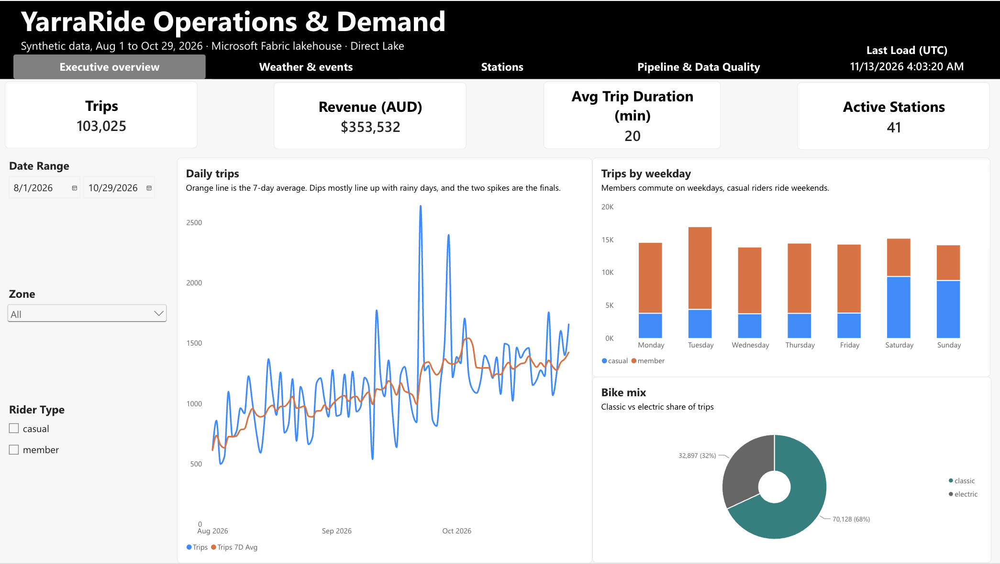
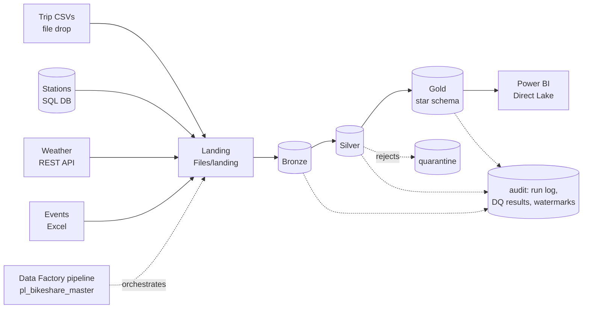
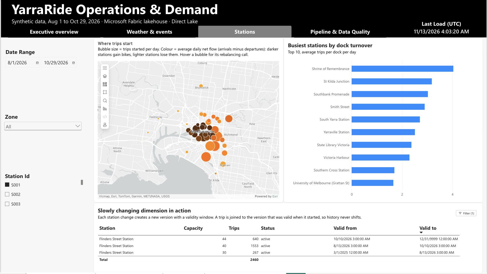
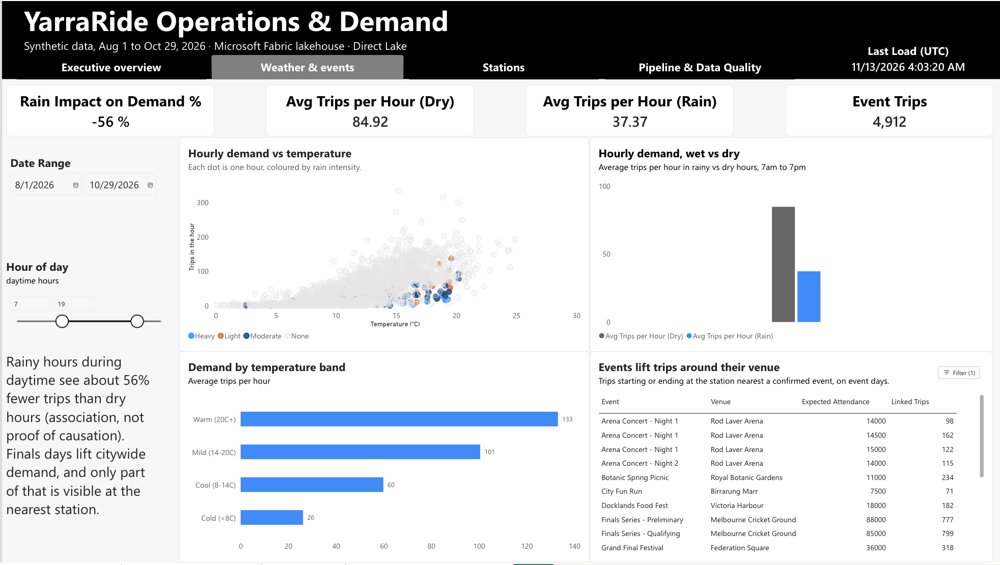
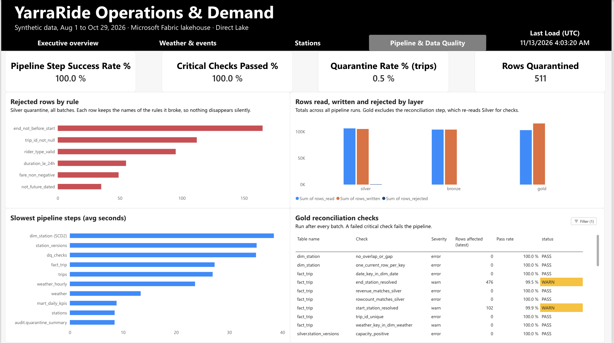

# YarraRide: an end-to-end Microsoft Fabric lakehouse

A bike-share analytics platform built the way a production data team would build it: **four heterogeneous sources → Landing → Bronze → Silver → Gold → Power BI**, with audit columns on every layer, incremental loads, SCD Type 2, a data-quality framework that quarantines bad rows, and an automated test suite.

> The scheme ("YarraRide"), its trips, stations and events are **synthetic** (Aug 1 to Oct 29, 2026). Weather arrives through a mock of the Open-Meteo API response. The point of the project is the engineering, not the numbers.



## Architecture



Everything runs in one Fabric lakehouse (`lh_yarraride`, schema-enabled: `bronze`, `silver`, `gold`, `audit`). A Data Factory pipeline runs five notebooks in order and passes one `batch_id` (the pipeline run id) to all of them, so every audit row traces back to a single run.

## Skills demonstrated

| Skill | Where to look |
|---|---|
| Lakehouse + Medallion design | `src/bikeshare/{landing,bronze,silver,gold}.py` |
| PySpark | everything under `src/bikeshare/` |
| Data Factory orchestration | `pipelines/pl_bikeshare_master` (five notebook activities, success dependencies, retries, `batch_id` and `as_of_date` parameters) |
| Delta tables | `lakehouse.py` (`MERGE`, `replaceWhere`, `mergeSchema`) |
| API integration | `sources/weather_client.py` (back-off retries), `landing.land_weather` (date window with 1-day look-back) |
| Incremental loads | watermarks and a file ledger in `control.py`; per-layer watermarks; marts rebuilt only for affected dates |
| SCD Type 2 | `scd2.py` (staged `MERGE`, multi-version chaining, late-arrival handling) and the point-in-time join in `gold.build_fact_trip` |
| Data modelling | star schema, role-playing station dimension, Unknown members |
| Data quality | `dq.py`, quarantine tables, circuit breaker, reconciliation checks |
| Analytics engineering | marts, DAX measures, semantic model, tests |
| Power BI | `sm_yarraride` (Direct Lake) and a four-page report |

## Sources (all deliberately messy)

| Source | Type | Landing pattern |
|---|---|---|
| Daily trip files | CSV drop | copy files not yet landed; a file ledger makes ingestion idempotent; a column (`battery_pct`) appears mid-stream (schema drift) |
| Stations | SQL database (SQLite here; Azure SQL in production) | `WHERE modified_at > watermark` → Parquet; in-place `UPDATE`s become SCD2 history |
| Weather | REST API (Open-Meteo response shape, mocked) | date window with 1-day look-back → raw JSON |
| City events | Excel workbook | banner rows, text numbers and dates; copied when its content hash is new |

## Layers

| Layer | What happens | Audit columns |
|---|---|---|
| Landing | raw files, immutable | n/a |
| Bronze | append-only Delta; trips and events kept as strings; schema drift absorbed | `_batch_id`, `_source_system`, `_source_file`, `_ingested_at`, `_ingest_date` |
| Silver | typed, de-duplicated, validated; failed rows quarantined | `_batch_id`, `_processed_at`, `_row_hash` (plus inherited lineage) |
| Gold | star schema and marts | `_batch_id`, `_loaded_at`; SCD2 adds `_valid_from`, `_valid_to`, `_is_current`, `_row_hash` |

Idempotency comes from a business-key `MERGE` plus a hash of the row, so re-running a batch never creates duplicates. Watermarks are written as *pending* and promoted only after the next layer commits, so a failed run retries from the same point.

## Data quality, the interview highlight

The simulator injects production-style defects and writes a ground-truth ledger the pipeline never sees. A test reconciles the ledger with what Silver quarantined or flagged:

| Injected defect | Injected | Caught | Where |
|---|---:|---:|---|
| end before start | 165 | 165 | quarantine `end_not_before_start` |
| trip over 24h | 55 | 55 | quarantine `duration_le_24h` |
| negative fare | 49 | 49 | quarantine `fare_non_negative` |
| missing trip id | 112 | 112 | quarantine `trip_id_not_null` |
| invalid rider type | 95 | 95 | quarantine `rider_type_valid` |
| future-dated | 35 | 35 | quarantine `not_future_dated` |
| missing end station | 476 | 476 | kept and flagged (`warn`) |
| orphan start station | 102 | 102 | kept and flagged, mapped to the Unknown member |
| false start under 60s | 840 | 839 | kept and flagged |

Result of the full load: **104,015** Bronze trip rows → **103,025** Silver/Gold trips, **511** quarantined, **479** duplicates collapsed. Three tiers: reject, keep-and-flag, repair. A 5% circuit breaker stops the run if an upstream file is broken, and every rule result is stored in `audit.dq_results`.

## SCD Type 2 in action

`dim_station` keeps one row per station version. For example, station S001 goes from capacity 30 to 40 (Aug 13) to 44 (Oct 10). `fact_trip` links each trip to the version that was valid when the trip started, so history never shifts after a change.



## The report

| | |
|---|---|
|  |  |

What the data shows (it is synthetic, so treat these as demonstrations of the method):

- Members ride on weekdays, casual riders on weekends.
- In daytime hours (7am to 7pm), rainy hours see about **56% fewer trips** than dry hours. This is an association, and the simulator builds the effect in, so it also acts as a check that the pipeline preserves the signal end to end.
- The two finals days lift demand citywide. "Event trips" counts only trips at the station nearest the venue, so it is a lower bound on the real effect.

## Repository layout

```
src/bikeshare/        pipeline code (landing, bronze, silver, gold, dq, scd2, control, audit, lakehouse)
src/bikeshare/sources/  the simulated upstream systems and the Open-Meteo client
notebooks/            00_simulate_sources, 01_landing, 02_bronze, 03_silver, 04_gold
pipelines/            Data Factory pipeline definition
powerbi/              DAX measures and semantic model notes
tests/                unit and end-to-end tests
docs/img/             report and pipeline screenshots
```

## Run it

**In Fabric**

1. Create a lakehouse `lh_yarraride` with *Lakehouse schemas* enabled.
2. Upload `src/bikeshare/` to `Files/code/bikeshare/`.
3. Import the notebooks, attach the lakehouse as default, and run `00_simulate_sources` through `04_gold` in order (or run the pipeline with an `as_of_date`, for example `2026-10-29`).
4. Create the semantic model from the Gold and audit tables and open the report.

**Tests (local)**

```bash
python3.12 -m venv .venv && source .venv/bin/activate    # Python 3.11 to 3.13, Java 17 required
pip install -r requirements.txt
BIKESHARE_FORMAT=parquet python -m pytest -q     # offline stand-in for Delta
BIKESHARE_FORMAT=delta python -m pytest -q       # full Delta run, downloads jars
```

The suite has 6 unit tests (SCD2 logic, DQ engine, transforms) and 12 end-to-end tests (injected-defect reconciliation, row conservation, schema drift, SCD2 history, point-in-time fact joins, idempotent re-runs).

## Limitations and design notes

- **Synthetic data.** Everything is generated. Weather is a mock of the Open-Meteo response, and trip demand is driven by that mock weather. A live-weather client is included but has not been run against the real API, and switching to real weather would break the trip-to-weather relationship.
- **Station extraction is snapshot-based.** The SQL source is read by `modified_at`, so a change that is reversed between two extractions would be missed. Real change-data-capture would fix that.
- **Orchestration.** The pipeline runs the notebooks in order and stops on failure (the Gold notebook raises if a critical check fails). It has no failure-notification branch.
- **Direct Lake.** The semantic model reads Delta directly, so no scheduled refresh is needed.
