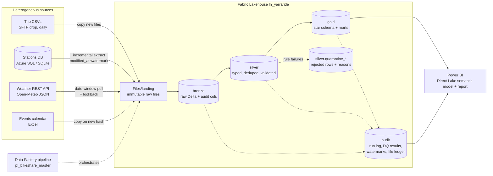
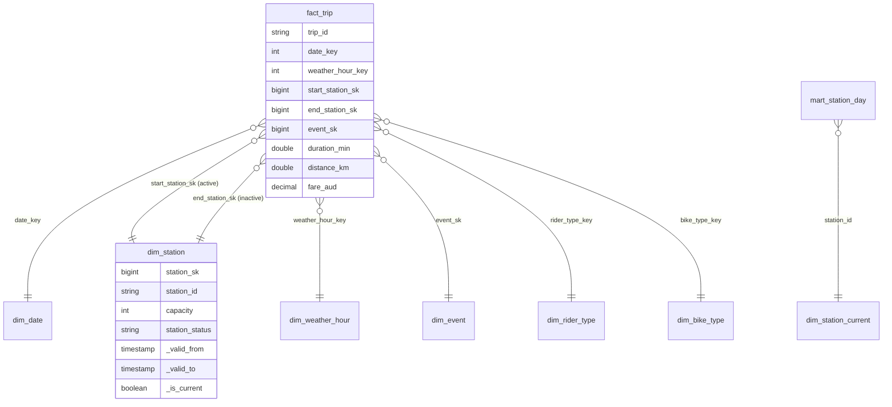

# Architecture

## Layer contracts

| Layer | Contents | Load pattern | Audit columns |
|---|---|---|---|
| Landing (`Files/landing`) | files exactly as received | add-only, never modified | file name / folder = lineage |
| Bronze | all strings (trips, events), typed Parquet (stations), raw JSON arrays (weather) | append; file ledger / batch folder = idempotent | `_batch_id _source_system _source_file _ingested_at _ingest_date` |
| Silver | typed, conformed, deduped, validated | incremental by Bronze `_ingested_at` watermark; `MERGE` upsert on business key, unchanged rows skipped via `_row_hash` | `_batch_id _processed_at _row_hash` + inherited `_source_file _ingested_at` |
| Gold | dimensional model + marts | fact: watermark on Silver `_processed_at` + `MERGE`; SCD2 dimension: staged `MERGE`; marts: `replaceWhere` only the affected dates | `_batch_id _loaded_at` (+ `_valid_from _valid_to _is_current _row_hash`) |

## Dimensional model

Grain of `fact_trip`: **one trip**. Measures are additive (`duration_min`, `distance_km`, `fare_aud`) except flags
(`is_round_trip`, `is_short_trip`, `has_dq_warning`) which are summed as counts.

## Key design decisions 

1. **Landing before Bronze.** Raw files are kept so Bronze can be rebuilt without going back to the source (replay/backfill).
2. **Watermarks are promoted only after the next layer commits** (`stations.modified_at@pending` -> `stations.modified_at`),
   so a failed run is retried from the same point instead of skipping data. Delivery is at-least-once; Silver/Gold are idempotent.
3. **Idempotent by construction.** `MERGE` on business keys + `_row_hash` change detection means re-running a batch changes nothing
   (asserted in `test_rerun_is_idempotent_and_watermarks_advanced`).
4. **SCD2 with deterministic surrogate keys** (`xxhash64(station_id, _valid_from)`) and a point-in-time join in the fact, so history is
   never rewritten and a Gold rebuild yields identical keys. An *Unknown* member (`-1`) absorbs orphan keys instead of dropping facts.
5. **Snapshot-extraction limitation.** The OLTP table only exposes its current state, so SCD2 captures one version per extract; changes
   between two extracts are collapsed. The SCD2 engine itself handles several versions per key in one batch (unit-tested) - with CDC
   (Fabric mirroring / change tracking) nothing would be lost.
6. **Timestamps are Melbourne wall-clock time stored in a UTC session** (no DST conversion). Simple and consistent, but a production
   system would store UTC + a time zone.
7. **Pipeline fails loudly:** circuit breaker on rejects, failed reconciliation checks fail the run, `Fail` activity in Data Factory.
